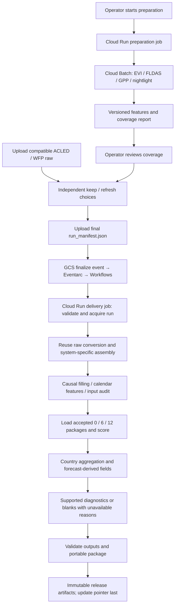

# October cloud delivery — technical specification draft

Revision 0.5, 2026-10-07. **Approved for supervised implementation; historical lineage gate removed by explicit user instruction. Deployment is not authorized.** Requirements authority: [prd.md](prd.md); execution authorization and checkpoints: [supervision.md](supervision.md). Evidence baseline: `4a42f1f666a4f2d5d2616069fe25ddd81f2662cb`. Old Spec Kit/Superpowers files provide historical evidence only; Trellis governs this task. Section 10 records gate status and remaining evidence requirements.

**Latest instruction:** stop historical provenance investigation. Reuse fixed features directly; build remote features preferentially from this repository's existing scripts. Current script/product/grid/reducer/key contracts define the new operational construction baseline. Do not require recovery of the old canonical-panel writer, a historical FID crosswalk, or proof of identical historical extraction before implementing. Preserve native IDs with explicit keys and validate current outputs; describe known historical differences without additional archaeology or claiming historical parity.

## 1. Outcome and boundaries

Deliver FEWSNET and IPCCH predictions at O, O+6, O+12 using accepted existing 0/6/12 packages. October 2026 means October 2026, April 2027, October 2027. An old input observation does not move the forecast origin. Existing h5 models/diagnostics are not renamed to another horizon.

Cloud preparation refreshes EVI, FLDAS, GOSIF-GPP and nightlight features. Operators independently retain or upload ACLED/WFP raw. A final immutable manifest requests batch scoring and complete CSV/package delivery. Training, a persistent prediction API, a new UI, and scheduled preparation are excluded.

Missing diagnostic support is publishable with null diagnostics and explicit reasons. Missing required model input with no allowed fill, failed prediction, or invalid release integrity blocks the whole formal release. These are separate conditions.

## 2. Proposed architecture and reuse



The event path and added sources are proposed work, not existing deployment. Use one small Workflows definition to filter the request object and invoke a configured Cloud Run Job; do not build an HTTP receiver or general workflow framework. Cloud Run executes the batch delivery and then exits. Batch retains the existing role of running remote-sensing export/extraction. The new delivery path calls shared scoring code directly; it does not call FEWS `run_latest`, which submits training.

Use a small delivery entrypoint under `cloud/orchestrator/` to compose the existing functions. Keep the old IPCCH EVI/Vertex entry available during migration instead of turning its tightly coupled 1,049-line flow into a generalized engine. Use the same accepted runtime image for preparation/delivery where compatible; pin the Batch image separately if the accepted model environment differs. Final image layout depends on model-environment acceptance, not a speculative container framework.

| Responsibility | Reuse | Required change |
|---|---|---|
| Cloud storage and artifact identity | `cloud/common/object_store.py`, object-reference validation | Generation-bound reads and input contract for this delivery |
| Run protection | `cloud/orchestrator/run_state.py` | Bind request generation/hash; handle identical duplicate events without redoing work |
| Remote extraction | `cloud/batch/evi_*`, GEE export code, legacy source scripts as numerical references | Latest-period discovery and explicit FLDAS/GPP/VIIRS extraction, both polygon universes |
| Raw conversion | `tools/refresh_h5_inputs.py` | Explicit source paths/cutoff, independent keep/refresh; preserve formulas |
| Assembly/features | IPCCH monthly builder/cloud assembly; FEWS normalization/preprocessing | Fixed-O rows, verified source overlays, causal filling and audit, remove fixed April assumptions from new entry |
| Scoring | IPCCH shared `run_scope`; FEWS core inference and saved-package loader | Use accepted 0/6/12 packages with O as feature month, no fitting |
| Country outputs | `tools/build_fewsnet_country_level_predictions.py`, `tools/build_ipcch_country_level_predictions.py` | Scope-aware paths and current predictions |
| Diagnostics | `tools/revise_h5_country_v3.py` math and v3 support rules | Bind correct model/horizon evidence, eliminate fixed h5/external research path assumptions, support explicit unavailable |
| Packaging/release | `tools/package_h5_delivery.py`, `cloud/orchestrator/release.py` | Three-horizon inventory, portable scoring inputs/runtime, generation-CAS publication |

## 3. Preparation and operator handoff

1. Operator supplies O, a unique `prepare_id`, and an immutable preparation-input manifest. It pins both native rosters/geometries, baseline histories, fixed assets, and extraction-contract version. Preparation may run again under a new ID.
2. Query each provider for the latest eligible monthly product at the preparation cutoff, at or before O. Save collection/image IDs or downloaded-file hashes, query time, source observation period, provider publication/completeness information when available, and retrieval outcome.
3. Fetch missing/updated periods needed to extend the accepted historical series through the latest eligible observations. Retain the required lag/rolling history; do not download only the most recent image and leave intermediate months unexplained. Pin unchanged historical partitions. Provider revisions become new snapshots, never edits to accepted history.
4. Run extraction for FEWS and IPCCH geometries separately, reusing fixed features and native geometry assets. Pin the current selected scripts' CRS, masking, source grid, reducer and scaling. Use explicit native polygon keys; no historical crosswalk investigation is required. Shared raster bytes may be reused; polygon outputs are not interchanged.
5. Produce `prepared_manifest.json`, `source_coverage.csv`, and preparation validation reports. Each source/system records latest observation, covered months/areas, missing coverage, product/version and checksum. Preparation failure is distinct from normal publication lag.
6. Operator reviews the report, independently chooses ACLED/WFP `keep` or `refresh`, and uploads compatible raw for each refresh choice. The final manifest pins the prepared snapshot and source selections. Raw upload alone does not trigger scoring; the final manifest does.

**Monthly eligibility rule, G1 confirmed on 2026-10-07:** use the latest provider-published completed monthly remote-sensing product available at the preparation cutoff and at or before O; exclude an unfinished current-month composite. A completed monthly product can still contain masked pixels, which are audited and filled under section 5. This rule does not reject partial ACLED/WFP raw observation coverage already allowed by September semantics. No freshness-age cap blocks an otherwise successful run.

Do not classify authentication errors, timeout, malformed products, or arbitrary HTTP failure as “latest month not available.” If the provider's availability cannot be established, preparation fails with evidence. No hidden automatic fallback to a stale prepared run is allowed. Reusing an explicitly selected successful prepared snapshot is reproducible; “latest” refers to its recorded preparation cutoff, not a moving lookup during scoring.

## 4. Input and manifest contracts

### 4.1 Raw upload

[research/raw-upload-contracts.md](research/raw-upload-contracts.md) defines the existing required columns and conversion semantics. Accept the current full CSV export formats and extra metadata columns. Raw filenames are arbitrary; object references determine identity.

- WFP: strict recorded day/month/year parsing, numeric Price/Trend, unambiguous series-month keys, `Aggregated` only; FEWS uses same-series previous-calendar-month percentage change +100; IPCCH uses Trend mean +100. Preserve their distinct sample SDs. Exclude Forecast before aggregation or coverage claims.
- ACLED: event-date parsing and existing event/admin grouping/nearest-point semantics. Preserve `_w5`=admin2 and `_w10`=admin1. Record partial coverage, dropped location-key rows and actual dates. Do not “correct” event filtering or coordinates as an incidental cloud migration.
- A refresh overlays only covered/supported source keys under the September policy, replacing the applicable feature family together and retaining uncovered history. `keep` pins an accepted prior source snapshot/transformed family. Avoid recomputing retained WFP with different raw/version semantics.
- Original CSV bytes are immutable. Parsing/schema/key failures are reported before formal release. Operator uploads supply the tabular data; no new ACLED/WFP API client is needed for this path.

### 4.2 Final request

Request object: `requests/{run_id}/run_manifest.json`, uploaded create-only. It is a new versioned delivery contract, not silently substituted into the old IPCCH ten-artifact manifest validator. Retain old contracts for their old entrypoints.

| Field/group | Required meaning |
|---|---|
| `schema_version`, `run_id`, `origin_month` | Explicit contract version, immutable identity, YYYY-MM O; path/run ID must agree |
| `systems`, `horizons_months` | Exactly FEWSNET and IPCCH; exactly 0,6,12; reject duplicates or relabeled models |
| `prepared_snapshot` | Exact preparation manifest reference and successful preparation identity, matching O/rosters/source contracts |
| `acled`, `wfp` | Independent action `keep` or `refresh`, exact retained snapshot or uploaded raw reference, converter-contract version |
| `models` | Six system/horizon package entries, hashes and accepted-model report references, feature schema/order and runtime identity |
| `assets` | Native geometry/roster, fixed features, population, country references, historical panels/target-feature history; all exact references |
| `diagnostics` | Per system/horizon/family: exact accepted evidence reference, or null with `unavailable` and reason; no h5 default |
| `contracts` | Feature/fill/output/diagnostic versions and hashes; selected policy is fixed, not arbitrary executable code |
| `runtime` | Accepted digest-pinned scoring image and dependency/environment manifest; must match the configured job |
| `release` | Approved release namespace and expected current-pointer generation captured for concurrency control |
| `operator`, `prepared_at` | Provenance of selection and preparation cutoff; do not infer who uploaded from filenames |

A GCS object reference includes URI, generation, and checksum. A directory/package reference resolves through a manifest enumerating its immutable members; a mutable prefix or alias alone is insufficient. The event supplies the request object's exact generation; the runner computes/persists its checksum and reads that generation. No circular self-checksum inside the request.

Paths for outputs and permitted asset roots come from the configured deployment, not unrestricted manifest shell commands. Validate month/horizon values, cross-system IDs, scope/model compatibility, source versions, prepared readiness, and image consistency before costly work. `run_status.json` is generated state and never overwrites the input manifest.

## 5. Feature construction, causal filling, and parity

### 5.1 Source semantics

The source/reducer table in [research/remote-sensing-contracts.md](research/remote-sensing-contracts.md) is evidence, not a complete model-column mapping. EVI uses raw-scaled MOD13A3 values; FLDAS uses its explicit 0.1-degree grid and 28 band mean/stdDev columns; GOSIF's SD path averages a provider SD raster; legacy VIIRS uses bilinear resampling/mosaicking and regional SUM/STD. Do not infer reducers from a feature named `mean`, `sd`, or `nightlight`.

For each adapter, record the selected current repository script, provider product/grid, reducer, scaling, nodata and explicit native key. Validate the implemented operation against that selected contract with local fixtures; no additional saved-panel-to-extractor historical tracing is required. Preserve known system-specific mappings where supported by the existing code; document the chosen operational mapping instead of claiming historical equivalence.

Follow-up evidence in [research/model-and-lineage-acceptance.md](research/model-and-lineage-acceptance.md) proves the CH branch maps provider-SD regional mean to `GPP_std` and regional nightlight SUM to `nightlight_mean`. It does not yet prove those mappings for the entire canonical IPCCH or FEWS training panel. The old CH notebook's ungrouped forward-fill/zero fill must not be reused: the user's area-specific causal fill rule takes precedence. Existing historical artifacts remain unchanged, and validation distinguishes intentionally changed missing-value handling from unintentional numerical drift. Trace negative-value preprocessing separately before extending it to all source branches.

New extraction uses explicit native ID properties, never implicit FID/record order. The inspected current geometry has persistent `admin_code,lat,lon`; replace old template `fid` selection with the native key for this new extraction. Recovery of historical FID mappings is no longer an acceptance requirement.

### 5.2 Calendar and filling

- Build rows for each accepted native polygon and calendar month required by O and its feature dependencies. Preserve IDs as strings. Do not generate new target labels or pretend filled observations were measured.
- Retain raw observations separately. For a missing base-feature value at month m, select that area's latest eligible observation at month <=m. Never take a later observation or another polygon's value. No arbitrary zero fallback.
- If no eligible history exists, apply only the accepted package's applicable imputation rule. Record package/rule identity; null `observed_month` is valid for model imputation. No valid input strategy means whole-release failure.
- Recompute feature dependencies after eligible base-series filling. FEWS EVI lags are exact calendar lags 1–12; nightlight's prior-12-month sum excludes the current month; WFP prior-4/prior-12 windows preserve existing definitions. Do not replace calendar joins with row shifts.
- Historical target-derived predictors remain distinct from truth/evaluation labels. Preserve observed label histories and their availability cutoff; do not fill an evaluation/training outcome table to fabricate diagnostic support. Apply only the verified feature-construction/package missing-value behavior for those predictors.
- Keep `feature_month`/`feature_period` equal to O, and compute targets by calendar addition. Original observation months belong in audit lineage, not substituted into forecast metadata.

FEWS climate zscore implementation (`core/normalization.py:217-226`) uses a whole-table rolling operation and per-admin statistics. Extending history may alter prior values. Freeze the accepted normalization behavior and its input snapshot through O; do not silently replace it with an intuitively preferable per-admin calendar algorithm. Acceptance must determine that this behavior is compatible with the chosen fitted package.

For O=2026-10, FEWS target-lag source months are 2026-06, 2026-02 and 2025-10; existing calendar joins leave missing labels missing for the saved imputer. Prior-12-month remote/WFP windows span 2025-10..2026-09; the 4-month WFP window spans 2026-06..09. The saved vocabulary includes year_2026/month_10. Check raw numeric month against parsed date and do not insert 2027 input rows merely because a target is in 2027.

### 5.3 Audit CSV

`reports/feature_fill_audit.csv` records system, horizon, native polygon ID, model feature, feature month, source feature, dependency month, source reference/hash, observation month, staleness months, fill method, imputation rule/package, and `derived_from_filled`. Multiple dependency rows are permitted for a rolling/lag feature; key them by system/horizon/polygon/feature/month plus dependency/source feature. Horizon is required because saved model imputation may differ between packages even when raw inputs are shared. Methods distinguish `observed`, `carry_forward`, and `model_imputation`. Staleness is measured against the input month being filled; O-relative age can be separately reported. Model imputation has no fabricated observation date.

The audit covers the feature values actually used at O and the historical inputs on which its temporal derivatives depend. No additional columns are required in September-compatible prediction CSVs. Coverage summaries distinguish source absence, normal lag, filled values and provider failures.

CP1 implementation clarification: base rows may remain `no_eligible_history` until calendar features are built. Record `source_sha256`, `model_package_id` and `feature_value_method` separately: the latter is `computed` or `model_imputation` for the final model feature. A saved rule for `EVI_lag3` must not be applied to base EVI and then represented as a measured or filled base dependency. Base gaps retain null observation dates, while final-feature imputation records the applicable saved package rule; no applicable final rule blocks release. Integration must bind this to the actual feature matrix and saved imputer, not infer it from an arbitrary base-feature rule.

## 6. Model acceptance and inference

Candidate packages are the existing IPCCH `model_artifacts/launch_2026_04` and FEWS `Outcome/fewsnet_partitioned_rf/model_artifacts/local-202604-57cb3b981198-510375f58cd8/{0,6,12}m`. Their presence does not certify fitness. Inspect package manifests, runtime requirements, exact feature order, imputation, fitted thresholds, partition routing and model hashes. Load/replay only in an accepted numerical environment after execution authorization.

The FEWS manifests require Python 3.12, numpy 2.4.2, pandas 3.0.0, scikit-learn 1.8.0, joblib 1.5.3 and imbalanced-learn 0.14.0, checked by the loader. The existing Python 3.11 FEWS image cannot load them under that contract. IPCCH models serialize as XGBoost 3.2.0 and save training medians, but lack a complete recorded training environment. A common Python 3.12 image with those pinned libraries and XGBoost 3.2.0 is a candidate pending replay, not an already accepted runtime. Keep loader checks enabled. FEWS uses its saved MaxPlusImputer values and IPCCH its saved per-feature medians; neither is refitted during scoring.

Acceptance binds package versions to an independently verified input contract, frozen-input prediction reproduction, October feature compatibility, native roster and numerical environment. It is operational/model-contract acceptance, not a claim of known future October accuracy. Do not accept based on feature count alone. A failure requires a reported decision; do not train, refit, retune or relabel h5 weights automatically.

For every system/horizon, construct the ordered accepted input, load the frozen model, score, and serialize in the September output schema with updated dates/model identity. FEWS uses the package's own threshold and partition/pooled routing, not h5's 0.43 by fiat. IPCCH retains four raw cumulative-share scores, >=0.2 cascade and population-share semantics; no clipping or probability normalization.

Run the six scoring combinations sequentially initially, reusing prepared features and bounded local files. Establish Cloud Run memory/time requirements during the authorized pilot; do not add a concurrency framework. If accepted packages cannot fit the proposed Cloud Run runtime/resource boundary, revise this design before production rather than silently moving execution or changing environments.

## 7. Country outputs and diagnostic availability

Country predictions reuse the current population-weighted aggregators and pinned population provenance. Census country reference population is not the weighting denominator. Keep missing population missing. Native model universes remain separate.

- FEWS country outcome: aggregated `probability_crisis >= 0.5`, independent of polygon model threshold; missing aggregate yields null.
- IPCCH country overall phase: >=0.2 cascade applied to population-weighted raw cumulative scores; no sum normalization. `country_maximum_phase` uses the full current roster, including zero-population areas. Missing/invalid current polygon predictions are integrity errors, not “missing diagnostic support.”
- Supported country error: population-weighted area error rates over positive finite populations and valid area evidence. No eligible evidence → null rate/flag. Confidence thresholds remain high <=.10, medium <=.20, low >.20 on unrounded values, with no quota.
- FEWS historical evidence must identify its real model family, horizon and evaluation method. Existing h5 fs1/4-month-lag proxy is not automatically allowed for 0/6/12. Do not create historical validation by applying the final model to its training rows and labeling it held-out.
- IPCCH Phase3+ errors remain training-resubstitution evidence for the corresponding accepted model/horizon; retain the actual fitted keys and >=.2 target definition. Missing exact replay lineage means unavailable, not h5 reuse.
- IPCCH maximum-phase proxy uses the matching horizon's complete-month joint residual fields transferred to the current scores, whole-month bootstrap with 10,000 replicates, PCG64 seed 20260923, stable ISO3/month ordering and linear 2.5/97.5 percentiles. Zero complete months → no point/interval; one → point only; empirical degeneracy is disclosed. Restart the documented deterministic procedure separately per horizon; record environment/settings. Do not label this calibrated uncertainty.

### Unavailable behavior

Retain every diagnostic table and expected polygon/country row. Only affected diagnostic estimates and confidence labels are blank; current predictions and forecast-derived country phase/outcome fields remain. Supported diagnostics in other families/horizons still compute. Do not fill missing error with zero or assign `low` merely because evidence is absent.

`reports/diagnostic_availability.csv` supplies `model_system,horizon_months,level,entity_id,diagnostic_family,status,reason,evidence_ref`. Status is `available`, `limited`, or `unavailable`. Reasons include `missing_evidence`, `no_eligible_area_history`, `no_complete_history`, and `single_month_interval_unavailable`. Missing declared evidence and known zero support are different: unknown counts remain blank; counts known from inspected evidence may be zero. Basis/method labels are populated only when established.

Keep existing September country status values where their definitions apply. For a missing entire evidence bundle, leave unsupported legacy diagnostic/status fields blank and use the explicit sidecar reason; do not pretend a missing bundle has been checked and found to contain zero complete months. IPCCH polygon training errors use the sidecar because their September schema has no status column.

An absent diagnostic reference can be explicitly `unavailable` at manifest time. A supplied reference with a checksum/identity failure, unexpected computation error, or malformed evidence is an integrity failure; do not hide it with a broad exception-to-null handler. An operator can issue a new manifest explicitly omitting unsupported evidence once the discrepancy is understood.

## 8. Output inventory and release semantics

Immutable release layout, G2 confirmed by the user on 2026-10-07 (paths are relative to a run's delivery root):

```text
manifest.json
bundle_manifest.json
webapp_model_bundle.tar.gz
README.md
requirements.txt
runtime/
fewsnet/{polygons.geojson,country_population_reference.csv,model_package/}
ipcch/{polygons.geojson,country_population_reference.csv,model_package/}
scopes/{0m,6m,12m}/fewsnet/{polygon_predictions.csv,country_predictions.csv,
                           polygon_model_mapping.csv,polygon_confidence.csv,
                           country_confidence.csv}
scopes/{0m,6m,12m}/ipcch/{polygon_predictions.csv,country_predictions.csv,
                         polygon_model_mapping.csv,polygon_training_errors.csv,
                         country_confidence.csv}
inputs/   # frozen O scoring inputs, identity/population; full histories separately inventoried
sources/  # raw sources or exact immutable source manifests, outside portable bundle
reports/  # coverage, fills, availability, evidence, QA, acceptance lineage and run status
```

This is 12 principal prediction CSVs, 18 mapping/diagnostic CSVs and two shared country-population CSVs, plus the audit/evidence CSVs. Geometry and accepted model assets are shared by scope where possible; each mapping points to its actual relative package path. No hard-coded September row/country counts: expected coverage comes from the accepted native roster.

Preserve per-system column names, order, string IDs, UTF-8/comma/dot-decimal encoding, blank CSV missing values, JSON null (no NaN/Infinity), native unsimplified geometries and existing anomalous-score reporting. FEWS month fields remain `feature_month,target_month,horizon_months`; IPCCH fields remain `feature_period,target_period,scope_months`. Extract and hash the September headers as the output contract; adapt only forecast dates, scope/model identities, dynamic numerical values and permitted null availability behavior.

The portable archive contains all six accepted packages, frozen scoring inputs, identity/population/geometry, runtime/dependencies, results, active diagnostic tables/status, and needed policy metadata. It must rescore and re-export from an extracted location without a repository checkout, external research directory or cloud credentials. Large raw/history snapshots remain outside the portable archive but inside the complete immutable inventory by exact references. Where a diagnostic requires large history, the archive may carry frozen, lineage-bound evidence for reproducing its delivered export, matching September's separation of scoring from full historical reconstruction.

Root `manifest.json` records validation success and a separate diagnostics availability summary; successful delivery never implies all diagnostics exist. Package verification must permit the approved unavailable state while checking that no unsupported values survived. Publish only after required CSVs, package and hashes validate. Do not copy an old h5 verification `passed` flag.

### Duplicate events, failures, and publication

Use the existing create-only run sentinel, augmented with request URI/generation/hash. First acquisition owns the run. A duplicate of the exact request performs no repeated scoring or pointer update; it returns the original execution/status reference without claiming the original has succeeded. Reusing a run ID for different request content/generation is a conflict.

No in-place resume, sentinel expiry or lease-recovery service is introduced. Failed/abandoned runs retain evidence; deliberate retry uses a new run ID and pins any reusable prepared/source snapshots. Configure the scoring task to avoid automatic whole-job retries that could be mistaken for resumable progress; native event redelivery remains harmless through run acquisition.

Eventarc filters the configured request bucket; the thin workflow also checks the exact `requests/.../run_manifest.json` path and forwards the object's generation. Source/report writes must not re-trigger scoring. Workflow completion or job submission is not proof of release success; durable run status and release manifest are authoritative.

Write accepted artifacts under a new immutable delivery prefix. Reuse generation-CAS publication: the manifest's expected pointer generation prevents two concurrent candidates from silently overwriting each other. A conflict retains the candidate and reports `release_conflict`; it does not force a new pointer value. Use a distinct dual-system release namespace during migration so the old IPCCH-only consumer is not silently redirected. Consumer cutover is a later explicit deployment step.

## 9. Acceptance mapping

| PRD criteria | Design coverage | Evidence needed during execution |
|---|---|---|
| AC1, AC9 | §§1,5,6 | Six correct package/horizon/date combinations, no fitting, exact feature order/runtime acceptance |
| AC2, AC2a, AC10 | §§3–4 | All sources/two rosters; four tabular choices; raw schema/coverage; explicit preparation→manifest handoff |
| AC3, AC3a | §5, §8 | Causal-fill examples and derived lineage; missing-input whole-release failure; staleness-only publishable |
| AC4, AC7 | §§2,4,8 | Generation-bound event, duplicate no-op, run collision, failure preservation, CAS conflict |
| AC5, AC5a | §§7–8 | September inventory/schema comparison; null-diagnostic release and no false evidence; correct current outcomes |
| AC6 | §§5–8 | Frozen-input local/cloud feature and prediction parity, country arithmetic, supported diagnostics, relocated bundle replay |
| AC8 | §§10 and implementation plan | User alignment on the persisted documents, convergence pass, final planning review |

## 10. Grill register and technical acceptance gates

**G1 — Resolved, 2026-10-07:** the user selected provider-published completed monthly remote-sensing products only. Section 3 is authoritative; O stays fixed and the approved filling/staleness behavior remains. This is distinct from already accepted partial tabular raw coverage. Do not reopen this choice.

**G2 — Resolved, 2026-10-07:** the user adopted the three-scope directory layout in §8, shared per-system geometry/population references, and one portable archive. September artifact classes and CSV fields remain; consumers select the horizon subdirectory. Do not reopen this choice.

**G3 — Resolved, 2026-10-07:** the user adopted immutable submitted manifest/data versions, retained failed-run evidence, deliberate retry under a new run ID with reusable prepared snapshots, and no repeated scoring for identical duplicate events. No in-place resume or moving-provider lookup during scoring. Do not reopen this choice.

Technical acceptance gates (facts to investigate, not preference questions):

- T1 — Historical lineage gate withdrawn by the user on 2026-10-07: reuse fixed features and prioritize current repository scripts for remote construction. Stop canonical writer/FID provenance searches. Current implementation still validates explicit native keys, selected reducer/grid/scale/nodata and output coverage; it does not certify historical parity.
- T2 — Metadata evidenced; replay pending: FEWS exact environment/serialized imputer behavior and IPCCH saved medians/XGBoost model version are recorded. Existing Python 3.11 image is incompatible with FEWS candidates. Verify all six packages in the accepted environment before their use.
- T3 — Calendar facts evidenced; extension acceptance pending: October input vocabulary and exact target/remote lag windows are established. Freeze the existing named normalization version and cutoff-bounded panel; quantify extension effects before accepting October features. No silent normalization algorithm change or fabricated label fill.
- T4: confirm supported provider availability/completeness queries and immutable raster identity. No live 2026 availability has been claimed.
- T5: verify native Eventarc→Workflows→Cloud Run Jobs argument/generation mapping, configured resource names/service identities and feasible task resource limits before deployment. No live GCP state was inspected.

G1–G3 require no further user choice. M1 owns remaining executable model/input checks; M3 owns current-script adapter/provider checks and M5–M6 own trigger/deployment checks. Historical source lineage is no longer a stop condition. Runtime/package incompatibility and actual input/score failures remain reportable blockers. The documents do not certify future model accuracy or production deployment. Supervised implementation is authorized as recorded in `supervision.md`.
