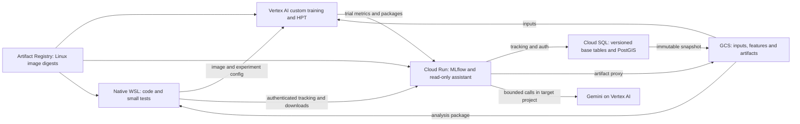

# Research cloud migration design

Status: approved for execution through the active goal, 2026-10-16. Requirements live in `prd.md`; `execution-authorization.md` records in-scope cloud authority and its limits. Technical gates still require evidence before provisioning or cutover.

## Architecture

Use one regional platform in `food-crisis-modeling-enso`; propose `us-central1` for SQL, GCS, images, Cloud Run and training, subject to project policy, availability and the priced proposal. Gemini may require a supported global endpoint; record this separately from data location.

Cloud Run hosts HTTP services; research training/tuning uses Vertex CustomJobs/HyperparameterTuningJobs. WSL uses the same **training image digest** as the corresponding cloud experiment. The MLflow service image separately pins 3.17.0 and assistant dependencies. Do not force incompatible historical numerical environments into one image.

## Resources and budget

| Resource | Proposed first configuration | Purpose / limit |
|---|---|---|
| Cloud SQL | Explicit Enterprise edition, PostgreSQL 16, single zone, `db-g1-small` candidate; 20 GiB SSD only if measured import/index/headroom fits | Separate `research`, `mlflow`, `mlflow_auth` databases/users in one instance; PostGIS in research. Daily managed backup with short retention; no HA. Shared core has no SLA and must pass representative import/query tests. |
| Cloud Run | Request-based CPU, min 0/max 1 instances, initial 1 vCPU/2 GiB, concurrency 8; one worker supporting concurrent self-calls | MLflow/assistant, explicit DB pool limit, foreground startup on `$PORT`. Measure upload memory, streaming, self-calls and timeout behavior. |
| GCS | Regional Standard, separate input/artifact buckets, uniform access, no public ACL | Immutable names and SHA manifests. No SQLite on bucket FUSE. Account for soft-delete retention and duplicated bytes. |
| Artifact Registry | One regional Docker repository | Service and family-specific training images by digest; retain images referenced by accepted packages. |
| Secret Manager | Required application secrets only | DB credentials, Flask secret, assistant credentials/Gateway key where required; never in image layers, Git or artifacts. |
| Vertex training | CPU, one worker per trial, one concurrent trial initially | Size from measured needs; explicit timeouts and budgeted retries. GPU needs a separately reviewed estimate. |

This is a low-cost research proposal, not an availability promise. Set edition explicitly rather than accepting an Enterprise Plus default. Do not provision an undersized database just to fit the budget.

Monthly allocations, **not quotes**: SQL including disk/backup/network USD 45; Cloud Run 15; GCS storage/operations/download egress 15; Gemini 10; registry/builds/secrets/logging 5; contingency 10. Total 100. Quote actual regional SKUs, inventory size, downloads and usage before provisioning. Training reads immutable GCS snapshots rather than repeatedly scanning SQL per trial. If measured needs exceed the envelope, stop before provisioning and revise with the user.

The separate USD 100 training envelope counts used/reserved costs plus workers × maximum duration × regional rate × trials, failed/retried work and relevant overhead. Use one owner-controlled submission path with a serialized reservation ledger. Reject a job exceeding the available envelope; keep estimates and billed observations distinct, and retain reservations until terminal job status is verified. This covers this workflow, not submissions outside it. Billing alerts are supporting signals, not spending caps. Without billing visibility, disclose the gap and obtain administrator figures before assuming funds are available.

Initial HPT smoke: two trials, parallel count 1, one CPU worker, at most 15 minutes/trial, no automatic retries. Include failures in cost. Larger future experiments have their own reviewed bounds.

Assistant calls have token/concurrency limits and a durable accumulated-cost check before dispatch against their allocation. Prefer supported existing Gateway limits when verified; otherwise implement only the required small application guard. Missing pricing/usage state prevents new paid calls. Billing delay, overhead and continuing storage cost mean this is not an exact platform-wide spending stop.

## Data and feature contracts

Two namespaces, `fewsnet` and `ipcch`, each have immutable versions. A version manifest names original files/roles, hashes, schemas, area/time keys, boundary identity, vintage and availability limitations. Preserve source bytes in GCS and load typed queryable tables into SQL. Validate row counts, key uniqueness, dates, missingness and numeric roundtrips. Area IDs remain strings; no silent geometry repair, label replacement, CRS conversion or null-to-zero fill.

FEWS NET uses D9's GeoXGB manifest and covariate extension, retaining its revised/latest-vintage limitation. IPCCH uses D10's raw panel and dependencies actually needed by recipes. Import only required files from `1.Source Data` and referenced supplemental directories. Prepared tables supplying otherwise unavailable static fields remain dependencies. AlphaEarth descriptor tables migrate; EE extraction does not.

Reuse family-specific feature builders. Each output binds dataset/recipe/code identity, ordered features, horizon, target semantics, missingness rules, availability and keyed train/validation/test cohorts. Preserve reported-phase versus share-derived outcomes. Oracle future observations remain labelled and excluded from ordinary feature assembly; migration does not certify historical real-time vintages.

Export/hash a consistent SQL snapshot once per experiment; trials reuse it. Retries cannot silently read newer data. Deduplicate immutable common inputs across runs while preserving accepted package dependencies. No blanket retained-weight deletion policy is introduced.

## WSL and Linux baseline

Proposed root: `/home/swl007007/projects/food-crisis-research/`, with `sources/Food_Crisis_Cluster`, `sources/IPCCH`, and a `control-plane` checkout of the current repository. A small `research_cloud/` integration directory belongs to the control checkout; it does not replace `cloud_pipeline/` or merge histories. Temporary runs/cache stay outside Git. Preserve remotes; no GitHub push is needed. Creating native WSL paths requires the appropriate filesystem permission during execution.

Capture commits and any required uncommitted source diffs explicitly; unrelated dirty files are not part of the release. Reuse scientific modules with input/output/runtime adapters. New Linux experiment contracts pin base image, numerical packages, CPU architecture, seeds and threads; preserve original locks in historical packages. Selected-data mounts suffice; no Dropbox parent mount.

Missing historical source or fitted transform is a dependency failure. Do not silently replace it with current code. Future Linux training is a new run/version, even when based on a historical recipe.

## MLflow migration

Preserve run/experiment/logged-model IDs, registered names/version numbers, timestamps and complete metric histories, descriptions, params/tags, datasets and model/metric relationships. Maintain an old-to-new URI map; retain original references as provenance. Do not rebuild via the existing result importer: it generates timestamps and is not a complete store copier.

1. Inventory schemas, relations, artifact paths and package completeness without printing secrets. Recheck source counts at the actual snapshot.
2. Rehearse a consistent copy into disposable local PostgreSQL at the same MLflow schema version. Use a bounded one-time data converter based on actual schemas; preserve keys, types/nulls, foreign keys and sequences. Migrate auth password hashes/grants separately. MLflow schema upgrades alone do not convert SQLite data.
3. Transfer artifact bytes and verify per-file hashes and SDK downloads. Preserve `mlflow-artifacts:/` relative layout where possible; explicitly map local absolute paths and feature-list references into cloud-resolvable artifacts. Do not rewrite arbitrary historical provenance.
4. Reconcile keyed records/histories and all version/model/dataset relationships, not just counts. Test interruptions, resume and same-size corruption. Existing verification helpers cover only portions of this.
5. Freeze all source writers for a brief final maintenance window, snapshot tracking/auth/files, transfer the delta and reconcile again. The existing importer lock alone does not freeze API writers. Keep the local service/store for rollback, read-only after cutover.

Use authenticated MLflow artifact proxy downloads first. Test the largest actual package under Cloud Run memory, timeout, streaming and transport limits. If native transfer cannot support it, use hash-manifested parts behind the same authorization. Never expose permanent public URLs or public buckets.

Historical external descriptors remain descriptors, with explicit inference-package links on their source run/version. Do not claim `models:/` loading works without implementing it. New models may use a supported MLflow flavor or the documented package loader; every package has a working download/load command.

## Package and relaxed numerical acceptance

Packages contain weights, feature order, fitted preprocessing, decoder, routing/partitions/calibration, minimal loader code, Linux environment pin, original-runtime record, keyed reference sample and checksums. The download command resolves and verifies any immutable external dependencies so the resulting package supports offline inference. A version representing many regions/fit blocks must include every required component.

Before comparison, select deterministic saved-prediction rows per retained fitted component: up to 32 (all if fewer), covering applicable routes/arms, missing-feature paths and decision boundaries where available. Freeze keys, input hashes and original predictions. Missing reference outputs remain an acceptance gap; do not generate target results and call them historical truth.

For historical probability/share outputs in [0,1], propose:
`abs(new - reference) <= 1e-3 + 1e-3 * abs(reference)`.

This allows 0.1 percentage point absolute error plus a 0.1% relative term. Check every sampled value and report maximum/mean error, failed keys and counts. Shapes, keys, missingness, feature order, routing and preprocessing contracts remain exact; tolerance cannot excuse the wrong loader.

Report classification changes separately. Threshold-decoded changes are allowed only if the saved score lies within the allowed error of the documented boundary and continuous outputs pass. An argmax change must be between nearly tied top classes with a reference gap no larger than twice the per-score tolerance; report both classes/margins. Other class changes fail. Label accepted boundary drift explicitly rather than claiming identical predictions. Non-normalized outputs need a unit-specific bound recorded before comparison; no post-failure bound inflation without a reviewed change.

Future cloud/WSL checks use the exact training image and tighter supported bounds. D11 permits historical platform drift, not changed scientific behavior.

## Access and assistant

Keep the existing basic-auth experience, with PostgreSQL permission storage. HTTPS transport may admit requests without GCP identity to reach the login challenge, but MLflow authenticates every content/download/API route. Only a content-free health route may be anonymous. Test artifacts, datasets, logged models and assistant endpoints as well as UI; IAM invoker settings alone do not establish content permissions.

Principals: owner administrator; existing invited readers; dedicated job writers; READ-only assistant with required Gateway endpoint USE. Scope Cloud Run identity to its databases/artifacts/secrets/provider access and training identity to immutable inputs, its outputs and MLflow writes. Neither is project admin. No anonymous signup or reader privilege escalation.

Reuse command allowlists and feature-query helpers. Set localhost self-calls to the runtime port. Verify pinned version, patch activation and assistant permissions at startup; refuse to enable the assistant on failure. Query/cache files use bounded scratch paths; no general shell/file access. Test streaming and concurrent self-calls under the chosen server configuration.

Rebind provider usage to the target project. Prefer workload identity/ADC if the pinned Gateway supports it; otherwise separately review a narrowly scoped credential for this endpoint. The old-project key is not the final credential. Gateway re-encryption/key handling is sensitive migration work and cannot print values into logs/artifacts. Provider/model compatibility is an acceptance gate; do not silently omit D7 or substitute a model.

## Training and tuning

Thin adapters take an input manifest, feature recipe, parameters, validation split, output prefix and MLflow identity. Reuse FEWS pooled fold/fitting logic and IPCCH share-regression/preprocessing functions. Record source commit/diff, image, parameters, data/features, seed, cohort/metric identities, artifacts and failure state. HPT trial runs link to their job and parent run; Vertex receives the same validation metric through its supported reporting interface. Missing/invalid objective fails the trial.

Use time-respecting research validation, excluding holdout from search. FEWS crisis F1 and IPCCH share/phase metrics retain separate contracts. Add a new configurable trial entry; do not change frozen historical parameter lists or disable FEWS `DOWNSTREAM_ALIGNED`.

Acceptance runs a small experiment for each data family and two-trial tuning on one family. This demonstrates the research platform and extension point, not a rewrite of every historical scientific driver into a generic tuner. Downloads/inference still cover all retained historical versions.

## Cutover and rollback

Cut over only after AC1-AC8 pass. Leave local/Dropbox bytes intact. Publish cloud URI/login, WSL setup and download/load commands. Changing existing Cloudflare DNS/hostname or stopping the old service is a separately reviewed final operation; the Cloud Run HTTPS endpoint suffices for first acceptance.

Local remains writable authority until final freeze/snapshot. Then permit new writes only in cloud. If rollback follows new cloud experiments, preserve/export those writes before reverting; never overwrite them with the old snapshot. Failed packages block archival of their dependencies. Unrelated operational Dropbox consumers are outside this acceptance claim.

## Verified documentation and remaining checks

Public documentation read 2026-10-16, without project API calls:

- https://cloud.google.com/sql/docs/postgres/instance-settings — explicit edition; shared-core types have no SLA. Prices and actual resource availability remain unverified.
- https://mlflow.org/docs/latest/self-hosting/security/basic-http-auth/ — PostgreSQL auth `database_uri`, READ permissions. Latest docs do not prove all behavior of pinned 3.17.0; check the installed release.
- https://cloud.google.com/vertex-ai/docs/training/using-hyperparameter-tuning — custom container command handling, `cloudml-hypertune`, trial/parallel/failure limits. Pin the actual SDK contract before submission.

Local evidence: `research/migration-mechanics.md`. No quote, migration rehearsal, deployment, provider call or model replay has run.
